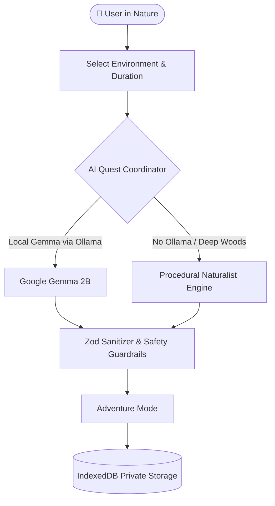

*This is a submission for the [Hacktoberfest Open-Source AI Challenge Week 1: Touch Grass](https://dev.to/challenges/hacktoberfest-week1-2026-10-05)*

---

# WildQuest AI 🌿 — Explore More, Scroll Less

> ### 📵 **The Reality Check**
> The average developer spends **8 to 11 hours a day staring at glowing screens**. Most modern apps are engineered as slot machines—maximizing session lengths, retention graphs, and dopamine loops.
>
> **WildQuest AI was built to do the exact opposite.** It is an AI companion designed to put itself away.

---

## 🧭 What I Built

**WildQuest AI** is a mobile-first, offline-first outdoor adventure companion powered by Google’s open-weight **Gemma 2B** model. Instead of keeping your eyes fixed on a screen, it generates personalized micro-adventures that invite you to step into your backyard, park, or trail to notice the living world with your own eyes and ears.

| Feature | The Modern Screen Trap | WildQuest AI 🌿 |
| :--- | :--- | :--- |
| **Primary Goal** | Maximize time spent in-app | Get you out of the app within 30 seconds |
| **Interaction** | Endless algorithmic feeds | One sensory prompt at a time |
| **Hardware** | Constant battery drain & notifications | High-contrast "Screen-Light" trail mode |
| **Privacy & Data** | Cloud tracking, ad cookies & location telemetry | **100% on-device (IndexedDB + Local Gemma)** |
| **Connectivity** | Fails completely without cell reception | **100% offline-ready with procedural fallback** |

### 🌿 Quests That Teach You to See Again
Users pick their immediate environment (*backyard, urban street, park, trail, waterfront*), their time window (*5 to 60 mins*), and their naturalist curiosities:

* 🍂 **Botanical Patterns:** *"Find three distinct leaf shapes on a single branch without picking them."*
* 🐦 **Acoustic Mindfulness:** *"Close your eyes for two minutes. How many distinct bird calls can you isolate?"*
* 🎨 **Color Perception:** *"Search for five different shades of green within ten steps of where you stand."*
* 🐝 **Pollinator Watch:** *"Observe bees or hoverflies on a blossom from two feet away without disturbing them."*

> ### 🛑 The Anti-Screen Philosophy
> When you hit **Start Exploring**, the interface shifts into **Adventure Mode** with a single instruction:
> 
> ```
> "You're ready. Look up. Put your phone in your pocket and observe."
> ```
> No feeds. No badges for streaks you missed. Just an unhurried invitation to look up.

---

## ⚡ Demo & Code

* 🌐 **Live Website (GitHub Pages):** [https://akashgt.github.io/wildquest-ai/](https://akashgt.github.io/wildquest-ai/)
* 📱 **Progressive Web App:** Fully installable on iOS, Android, and Desktop with offline caching.



---

## 🏗️ How I Built It

WildQuest AI operates completely at the edge. The system is architected around a dual-engine pattern so that nature exploration is never interrupted by lack of cell service:



### 1. Edge Intelligence via Google Gemma 2B
- Connects directly to **Gemma 2B** running on your device via Ollama (`http://localhost:11434/api/generate`).
- Strict JSON instruction prompts return structured micro-quests parsed through **Zod schemas** that strip unescaped HTML or unsafe markdown.

### 2. Dual-Engine Resilience (Offline Naturalist Engine)
- The best trails have zero cell service. If local Ollama is offline or unreachable, WildQuest AI seamlessly routes to its built-in **Naturalist Fallback Engine**.
- The app **never fakes connectivity**: the navbar status badge honestly reports whether Gemma or the Fallback engine generated your quest.

### 3. Non-Negotiable Safety Guardrails
* 🚫 **Zero Foraging / Ingestion:** Quests strictly prohibit tasting, eating, or picking wild plants or mushrooms.
* 🚫 **Zero Wildlife Harassment:** Always mandates safe viewing distances.
* 🚫 **No Trespassing:** Enforces public path awareness.
* 🚦 **Street Safety:** Instructs users to pause and step aside before looking up around traffic.

---

## 💡 Why Does Open Innovation Matter?

1. **🌲 Trailheads Don't Have Cell Towers:**  
   Cloud APIs from closed vendors break the second you hike into a canyon or state park. Open-weight models like Google Gemma run on local silicon—bringing intelligence to the wilderness without Wi-Fi.

2. **🔒 Personal Reflections Remain Sacred:**  
   Your thoughts, mental health pauses, and nature journal entries shouldn't train commercial models or feed behavioral ads. Open-weight models and IndexedDB keep your private life on your device.

3. **💸 No Tollbooths on Nature:**  
   Nature wellness shouldn't require an ongoing monthly API subscription or credit card. Open innovation democratizes tools so students, rangers, and community groups can run them freely.

---

## 🤖 My Agent Session

This project was built pair-programming with the **Google Antigravity** agentic AI environment, utilizing automated terminal execution, Vitest verification suites, browser subagent visual regression testing, and GitHub CLI workflows.

You can inspect the full interactive transcript of how WildQuest AI was designed, built, tested, and deployed below:



*(Direct Session Link: [dev.to/agent_sessions/building-wildquest-ai-offline-first-nature-exploration-with-local-gemma-9jlc1r](https://dev.to/agent_sessions/building-wildquest-ai-offline-first-nature-exploration-with-local-gemma-9jlc1r))*

---

## 🏆 Prize Categories

### 🌟 Featured Category: Best Use of Gemma ($200)
* **Local Edge Runtime:** Tailored specifically for Google's open-weight Gemma 2B model on Ollama (`gemma2:2b`).
* **Deterministic Guardrails:** Strict Zod schema validation ensuring safe, structured quest generation.
* **Truthful UI:** Real-time Ollama status testing with explicit Gemma vs. fallback labeling.

### 🛠️ Partner Category: Best Use of GitHub ($100)
* **Automated CI/CD:** Powered by [deploy.yml](https://github.com/akashgt/wildquest-ai/blob/main/.github/workflows/deploy.yml) running 17 Vitest unit tests, type-checking, and deploying PWA assets to GitHub Pages on every push.
* **Full Open-Source Compliance:** Production Apache 2.0 license, clean issue templates, and comprehensive documentation.

### 📜 Partner Category: Best Use of Entire ($100)
* **Interactive Agent Session:** Full transparent agentic session recorded and embedded directly into this submission via DevRelay Liquid tag (``) to show the development process from inception to production deployment.

---

*Explore more. Scroll less. Step outside and see what's blooming.* 🌲
